# Demos

## Information

These are built-in demo projects that are available to all users under the dropdown.

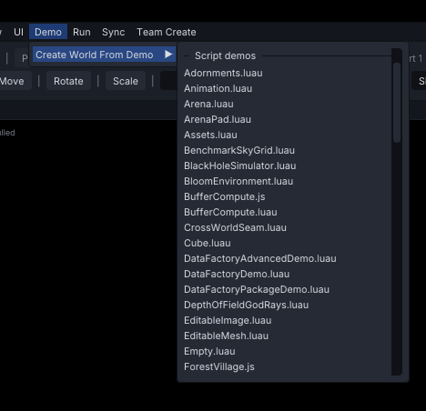

## Demo GIFs

### Blackhole Lens Effect
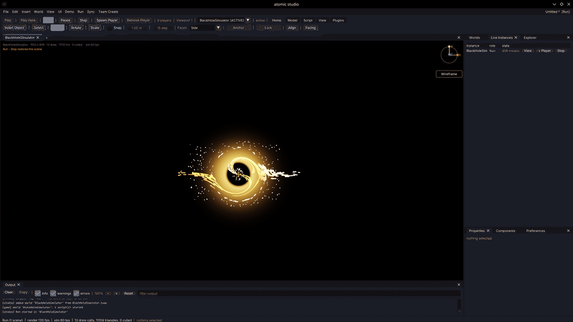

### Block Cyclone
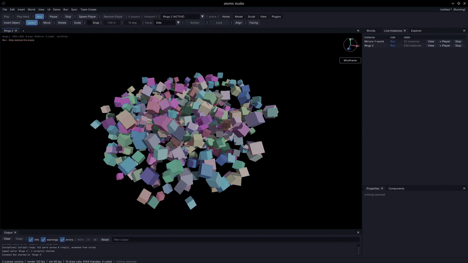

### Finite Repeating Mirrors
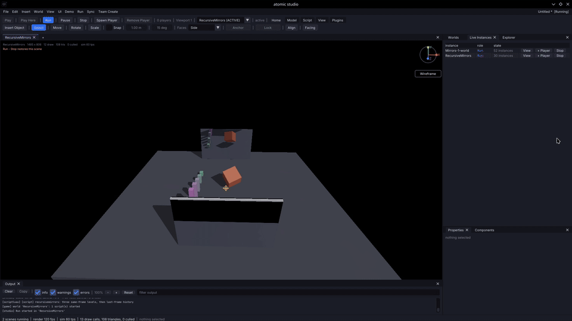

### Magic Framegraph
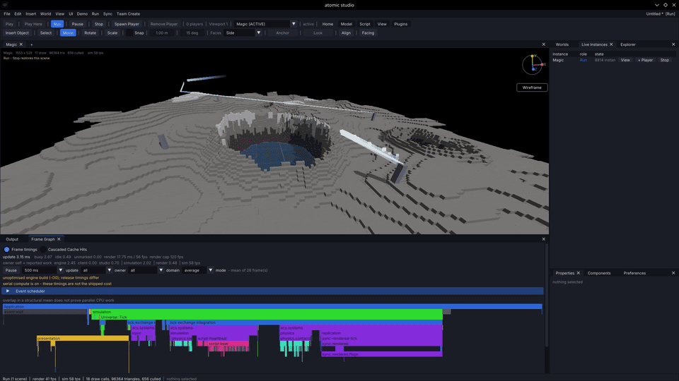

### Magic Heap
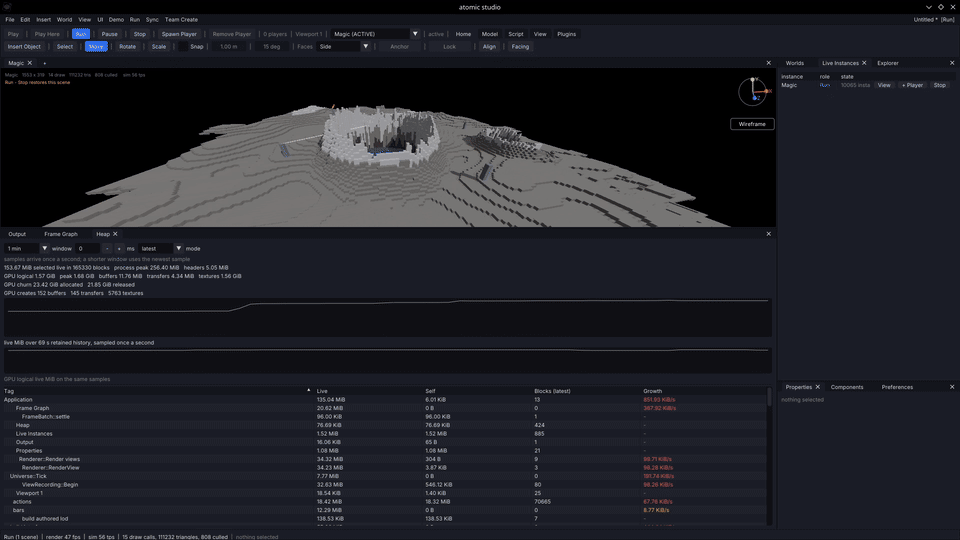

### Material Ball LOD
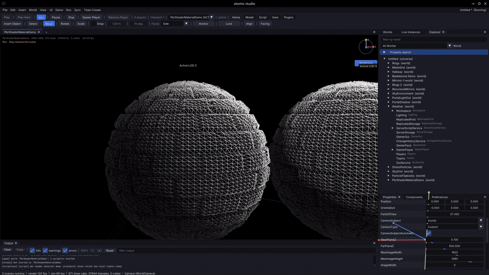

### Mirror Shaders
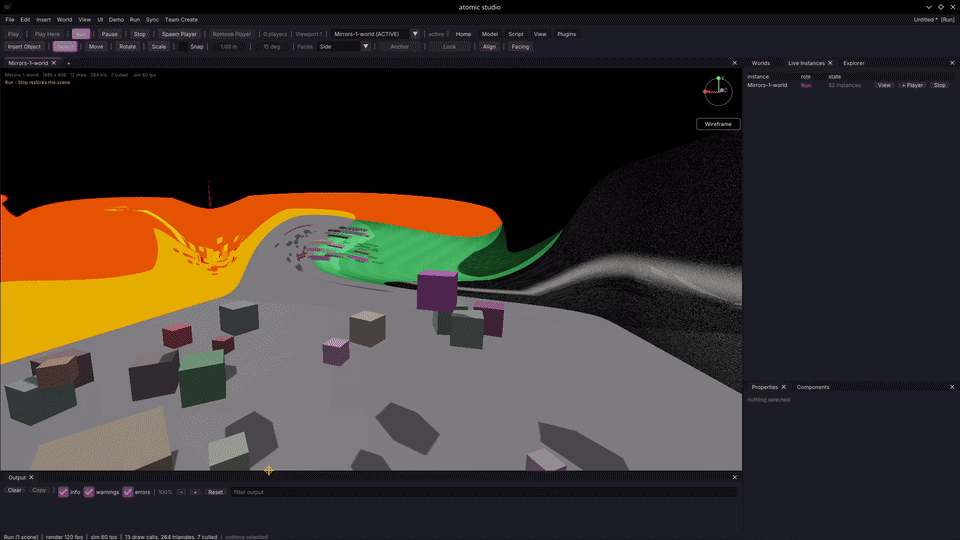

### Non-Euclidean Tunnels
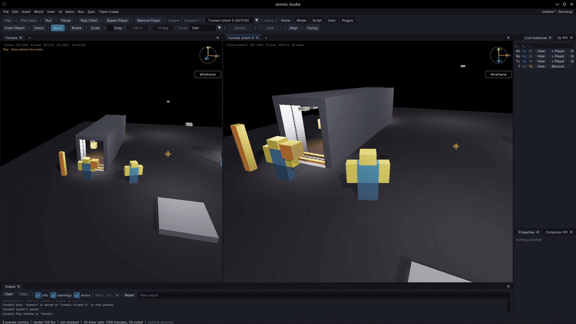

### Particle Flipbook
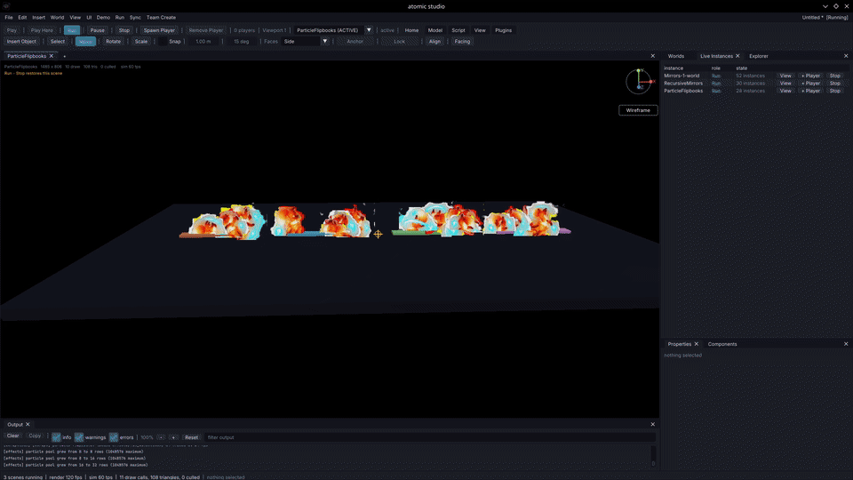

### Particles Stress

### Portal Lights
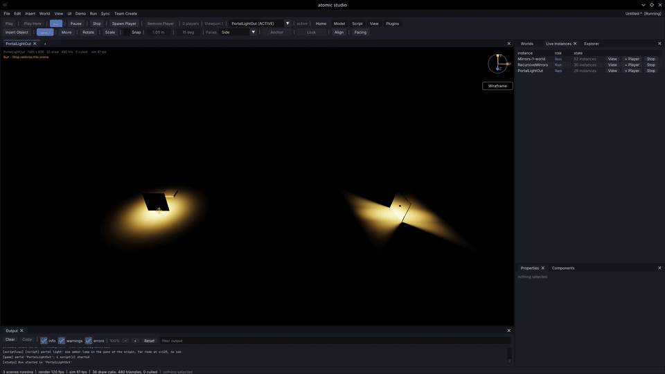

### Weather Volume Cloud
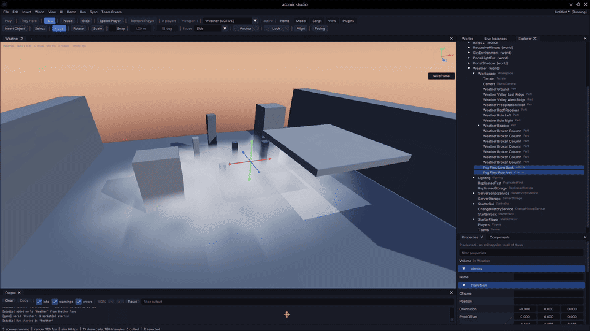

