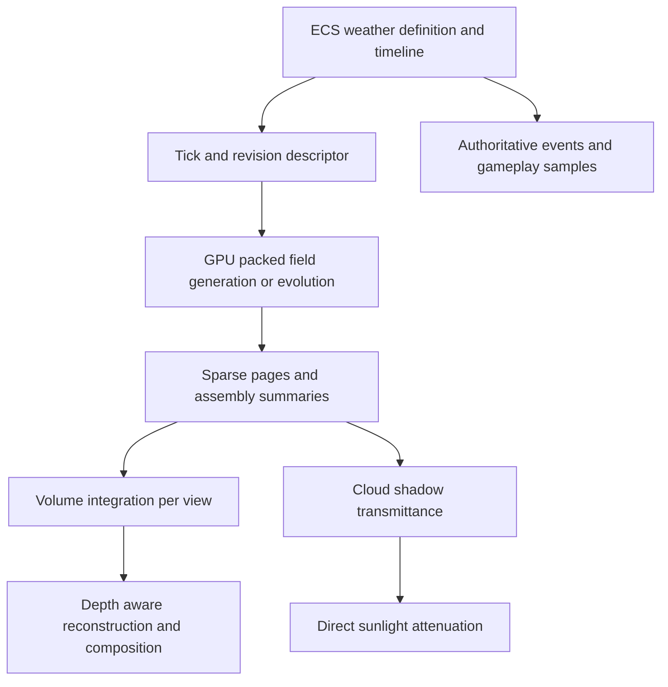

# Weather systems upgrades

## 1. Proposed system

Build seeded procedural clouds as part of one weather model shared by clouds,
ground fog, precipitation, wind and storms. Keep the resident volumetric field,
its sparse representation and its visual computation on the GPU. ECS owns the
authored settings, weather timeline and authoritative weather events. The
renderer owns disposable device resources derived from those inputs.

Use a directly evaluable procedural field for the first complete system. A cell
at a particular weather tick can be reconstructed from its world coordinate,
seed and timeline segment without simulating from world creation. This provides
deterministic initial conditions, time progression, bounded late joins and
recovery after GPU resource loss. It is a designed weather approximation, not a
numerical atmospheric forecast.

Support a separate stateful evolution mode when accumulated advection,
condensation and feedback are required. That mode needs checkpoints and bounded
replay. An arbitrary evolving fluid cannot be made seekable by wrapping its
clock. Both modes use the same cloud rendering and weather input contracts.

The deliverables are:

- Seeded initial conditions and reproducible progression at integer weather ticks.
- Packed GPU cells, GPU generation and compute-based volumetric visualization.
- Dense nearby bricks, coarse distant bricks and absent empty regions.
- Conservative culling and LOD maintenance on an approximately five-second cadence.
- Assemblies that merge similar cells and split with deterministic reconstruction.
- Atmosphere integration, fog/mist, rain, snow, hail, thunder and lightning.
- Optional cloud shadows with separate distance and quality controls.
- Server clock synchronization, late joins, save/load and world lifecycle handling.

This is an implementation plan. Formats, thresholds and performance figures
below are proposals or explicit arithmetic, not measured results. The current
`VERSION` is `0.26.0`; this document does not assign a release milestone or mark
roadmap work complete.

## 2. Existing engine integration

Extend the existing paths instead of creating another sky or particle system.

| Existing location | Relevant capability | Planned use |
|---|---|---|
| [Atmosphere.hpp](../mono.engine/scene/include/engine/scene/Atmosphere.hpp) | `Atmosphere`, `Clouds`, `CloudCompute`, fog and resolved environment state | Preserve authored appearance controls; add a weather-driven source |
| [Volume.hpp](../mono.engine/scene/include/engine/scene/Volume.hpp) | Placed participating media, extinction and bounded resolution | Share integration and bounds handling for clouds and local fog |
| [CloudDensityOctree.hpp](../mono.engine/scene/include/engine/scene/CloudDensityOctree.hpp) | CPU sparse density tree and packed renderer snapshots | Use as a reference fixture and migration input, not a second live cloud simulation |
| [GpuParticleField.hpp](../mono.engine/scene/include/engine/scene/GpuParticleField.hpp) | GPU cosmetic particle requests with ECS-owned initial conditions | Reuse for precipitation populations where its capabilities fit |
| [RenderEnvironment.cpp](../mono.engine/render/src/RenderEnvironment.cpp) | Cloud environment compute and retained result signatures | Integrate weather revisions and shared cloud field residency |
| [environment-clouds.comp](../mono.engine/resources/shaders/environment-clouds.comp) and [volume.frag](../mono.engine/resources/shaders/volume.frag) | Existing cloud and volume shader paths | Consolidate sampling and lighting when replacing their work |
| [Weather.luau](../mono.engine/examples/assets/scripts/Weather.luau) | Existing weather demo | Extend into the visual acceptance scene |

`CloudDensityGpuNode` is currently a 48-byte node containing eight child indices
and four floats. That is not a nine-byte weather cell, and tree overhead must
not be counted as cell payload. Keep existing callers working during migration;
remove the replaced production path after equivalent rendering is verified.
Retain a CPU tree only for callers that still need CPU-authored density.

Respect [CODE_ARCH.md](CODE_ARCH.md) and the module instructions:

- `scene`, L7 shared: semantic authored components and owned value snapshots.
  New GPU layouts, page-table offsets and device handles stay out of this module.
- A proposed `weather` module, L8 shared: pure weather evaluation, timeline
  resolution and authoritative weather scheduling. Depend downward on `scene`,
  `ecs` and `core`. Add its exact edges to
  `mono.tools/architecture/expected_graph.json` when implementation creates it.
- `render`, L12 client: packed device layout, brick residency, assembly compute,
  volume integration, shadows and temporal history. Built-in GLSL belongs in
  `mono.engine/resources/shaders/`.
- `graph`, L9 shared: resource and dependency vocabulary. Weather node handlers
  remain in `render`; the graph runtime never acquires a graphics dependency.
- `script`, L9, and its VM adapters: expose semantic weather controls and queries.
  Record new component purposes in `mono.tools/componentdoc/purposes.md`.
- `replication`, L12 shared: encode copied weather definitions, clock anchors,
  events and checkpoints. `mono.client` and `mono.server` wire services together.

If physics needs wind, inject resolved weather samples or a low-level sampling
port. Do not add a sideways L8 `physics -> weather` dependency. GPU weather,
cloud density and cosmetic precipitation must never feed gameplay queries.
Authoritative simulation retains the engine's strict IEEE and fixed-tick rules.

## 3. Parameters that produce useful variety

The requested six inputs are useful, but their meanings need to be distinct.
Cloud condensate is not air density. Relative humidity is not conserved water
content. Height is a coordinate rather than a substance that spreads.

| Requested parameter | Canonical meaning | Storage decision |
|---|---|---|
| Density | Physical condensate mass concentration in kg water/m^3, or a normalized visual proxy with a named conversion to that unit; rendering derives extinction | One quantized byte per resident cell; separate air-density approximation for buoyancy |
| Temperature | Temperature relative to an altitude-dependent reference profile | Signed byte anomaly; full reference profile on the layer |
| `y_level` | Altitude in metres in the weather coordinate frame | Derive from brick origin and cell index; store a layer base and brick coordinate |
| Humidity | Water-vapour mixing ratio in kg water/kg dry air, with relative humidity derived from temperature and pressure | One quantized byte; never conserve or average relative humidity as water mass |
| Wind velocity X/Y/Z | Metres per second, with horizontal drift, shear and vertical lift | Three signed quantized bytes using layer scales |
| Pressure | Anomaly about a reference pressure profile | Signed quantized byte; avoid eight-bit absolute pressure |

Add a small set of authored controls that the six inputs cannot express alone:

| Control | Effect |
|---|---|
| Coverage and condensate scale | Independent cloud amount and opacity |
| Cloud base, thickness and vertical shape | Flat sheets, detached layers and tall towers |
| Horizontal feature size and breakup | Large fronts versus small scattered cells |
| Stability/lapse profile and lift strength | Stable stratus versus rising cumulus |
| Wind shear and turbulence amplitude | Stretched clouds, billows and changing silhouettes |
| Moisture supply, condensation and evaporation rates | Growth, clearing and precipitation transitions |
| Ice fraction/freezing profile | High ice clouds and cold precipitation appearance |
| Front contrast and progression rate | Distinct air masses rather than uniform drifting noise |

Use correlated seeded fields at weather, cloud-body and detail scales. Their
scale ratios and vertical profiles provide more readable variety than giving
every cell unrelated random values. Separate purpose hashes for moisture,
temperature, pressure, body shape, erosion and split detail. Changing one
control must not reshuffle the unrelated fields.

Start with configurable bounded encoding ranges, for example temperature
anomalies within +/-32 degrees Celsius, pressure anomalies within +/-32 hPa,
horizontal wind within +/-64 m/s and vertical wind within +/-16 m/s. These are
prototype ranges, not assertions about the full range of real weather. Vapour
and condensate scales are named per-layer quantities with documented units.
Changing a scale increments the definition revision and invalidates packed data.

Preset scenes should cover clear, scattered cumulus, overcast stratus, towering
storm, wispy ice cloud and ground fog. Match each to a recognizable vertical
profile, moisture regime and wind field. Do not implement presets as independent
renderers.

## 4. Weather behavior

Pressure gradients accelerate air from high pressure toward low pressure;
rotation, friction and inertia modify the resulting wind. Pressure normally
decreases with altitude, so use pressure anomalies about a reference profile
instead of accelerating every cloud upward from the entire background gradient.
This corrects the rough high-to-low rule without requiring a forecast model.
See the [National Weather Service pressure and wind explanation](https://www.weather.gov/source/zhu/ZHU_Training_Page/winds/pressure_winds/Pressure.htm).

Wind advects vapour, condensate and temperature. Turbulent mixing spreads
concentrations. Temperature and moisture affect buoyancy; rising air cools,
and condensation begins when vapour exceeds the local saturation amount.
Cold air alone does not guarantee a cloud. Humidity, temperature and pressure
must be interpreted together. See the
[National Weather Service humidity explanation](https://www.weather.gov/lmk/humidity).

For the procedural mode, express these relationships through moving pressure
fronts, correlated moisture/temperature fields, altitude profiles and bounded
lift/deformation. Front displacement is derived from an analytically integrable
timeline wind, not accumulated independently by each client's render frames.
Use a smooth growth/decay envelope for each seeded cloud feature. Widening that
envelope can approximate mixing; it is not a mass-conserving diffusion solver.

For stateful mode, implement the following fixed-step pipeline:

1. Sample pressure-gradient and buoyancy forces, plus authored forcing and drag.
2. Update velocity using a declared compressible approximation or an
   incompressible velocity projection. Keep thermodynamic pressure distinct from
   the projection solver's numerical pressure.
3. Advect vapour, condensate and temperature from the previous state into the
   next state. Prefer a bounded conservative finite-volume scheme when claiming
   mass conservation; ordinary semi-Lagrangian sampling does not guarantee it.
   Compressible mode must transport or retain dry-air mass to recover vapour
   mixing ratio. An initial incompressible constant-density approximation must
   declare that assumption. Count these physical or residual fields outside the
   eight-byte cosmetic payload.
4. Apply bounded mixing, condensation and evaporation. Transfer equal water
   amounts between vapour and condensate; include the chosen latent-heat term.
5. Transfer precipitating condensate into the precipitation budget and transport
   it downward. Record source, sink and boundary flux totals explicitly.
6. Publish the completed state and its revision, then rebuild affected summaries.

Document domain boundaries: horizontal periodic wrapping is an explicit world
option; finite domains need defined inflow/outflow; ground has a terrain-aware
mask and moisture source; the top has declared escape behavior. Never sample a
missing page as empty if it contains an unsampled active neighbor.

Choose timestep and substeps from the smallest active cell size, maximum speed
and scheme stability constraints. A five-second maintenance interval is not a
simulation timestep. Reducing density to eight bits after every small step can
erase slow changes; retain higher precision or a quantization residual for
stateful evolution and include that memory in its budget.

## 5. Determinism and arbitrary-time reconstruction

Define three different guarantees:

| Surface | Required guarantee |
|---|---|
| Server weather events and gameplay samples | Same accepted definition, tick and event sequence produce the same authoritative result |
| Procedural cloud samples | Same seed, timeline, canonical lattice coordinate and integer tick produce identical packed reference samples on supported backends |
| Lighting, ray integration and temporal reconstruction | Same weather field and event timing; pixel equality across GPUs is not promised |

A seed and a server time do not make arbitrary floating-point GPU simulation
bit-identical. Operation precision, contraction and rearrangement matter. The
[Vulkan SPIR-V specification](https://docs.vulkan.org/spec/latest/appendices/spirvenv.html)
describes these freedoms. Treat backend determinism as a tested contract.

For the directly evaluable mode, define a versioned function:

```text
PackedSample = Evaluate(AlgorithmName, AlgorithmVersion, WorldSeed,
                        LayerName, TimelineSegment, CellCoordinate, WeatherTick)
```

Quantize control scales, coordinates and timeline inputs once with a versioned
encoding before CPU/GPU reference evaluation. Replicated canonical input words
must agree.

Use a named, fixed-width unsigned hash with specified overflow and bit order.
Use integer lattice noise, fixed interpolation/rounding rules, bounded integer
lookup tables and wider temporary products for the packed reference evaluator.
Specify every signed conversion and intermediate bound. Do not use floating
point `sin` hashing, hardware filtered samples, unordered reductions or atomic
arrival order in this evaluator. A CPU reference evaluates individual samples
for tests without maintaining a CPU copy of the resident volume.

The integer reference evaluator constructs a cosmetic packed field. It does not
replace the engine's strict IEEE authoritative simulation policy. Weather event
and gameplay evaluation lives in shared code under that policy; GPU lighting
may unpack samples into FP32 without feeding the result back into gameplay.

LOD and camera distance select how many reference samples to retain and how
finely to integrate them. They never select a different seed, canonical timeline
or server storm event. Coarse averages use fixed child order and integer sums.
Compact page indices may differ by device without changing coordinate-keyed data.

### Large time and seamless points

Carry time as a 64-bit weather tick on CPU and wire. Pass high/low 32-bit words
to shaders when native 64-bit integer operations are unavailable. Convert only
a bounded segment-local phase to float for visual interpolation. Also keep
world coordinates as integer brick coordinates plus bounded local offsets;
camera rebasing must not change hashes.

Keep a cumulative displacement at each timeline anchor. For constant or
piecewise-linear wind, evaluate the segment displacement directly, including
the anchor offset. A late join receives the current anchor, not the entire
world's previous wind changes. This avoids the incorrect `currentWind * totalTime`
shortcut when wind has changed.

Modulo is safe only for a field designed to be periodic. A looping feature must
match value and first derivative at the wrap point, and its displaced coordinates
must also return to an equivalent spatial phase. A local phase wrapping alone
does not reset a drifting front. Rebased epochs keep their seed and displacement
continuity. A quaternion does not solve the missing history of a fluid.

For non-repeating weather, schedule bounded deterministic feature lifetimes in
overlapping timeline windows. Evaluate the current window and the required
neighbor windows directly; fade features in/out with matching boundary slopes.
Retain enough overlap and displacement anchors to reconstruct the current field
without replay. Include authored changes in timestamped timeline records.

## 6. Server time, replication and checkpoints

Replicate a small weather descriptor, not every cloud cell. Proposed descriptor
fields are algorithm name/version, world epoch, seed, layer definitions,
parameter revision, current segment and displacement anchor, anchor weather
tick, tick rate and time scale. Stable layer and preset names cross saves/wires
as strings. Epochs, revisions, ticks and coordinates remain numerical values;
never serialize declaration-order IDs or `core::Name::Id()`.

Use existing connection timing data where available. Add timestamped clock
anchors and request/reply timing only where needed. Estimate clock offset from
multiple samples with round-trip information; receiving a time value is not the
same as knowing the server's time at receipt. Extrapolate with the local
monotonic clock. Wall-clock dates are not the progression driver.

Slew small clock corrections in the visual interpolation clock. Apply large
corrections by reconstructing the target field and invalidating affected
history. Render interpolation can lag by a small bounded amount, while server
events are indexed by exact ticks. Late, reordered and duplicate records are
handled by epoch, revision and event sequence.

| Lifecycle case | Recovery |
|---|---|
| Late join in procedural mode | Receive the current descriptor and evaluate the required bricks at the target tick |
| Resource eviction or graphics device reset | Recreate only desired pages from the same descriptor |
| Pause, time scale change or world suspension | Apply an explicit tick-stamped timeline anchor; resume according to the world's pause policy |
| Save/load or server restart | Restore epoch, seed, settings, clock anchor, displacement and event sequence |
| Portal or world transfer | Use the destination world's descriptor; never borrow a pointer or GPU page from another world |
| Definition/version mismatch | Refuse incompatible decoding, request supported data or show the explicit visual fallback |

For stateful mode, time alone is insufficient. A checkpoint contains its exact
tick, algorithm/encoding version, canonical domain and resolution, complete
packed fields, required high-precision residuals, topology, boundary/forcing
state and subsequent ordered events. Replay only a bounded interval from the
latest compatible checkpoint. Budget checkpoint bytes and admission bandwidth.

Prefer a fixed canonical stateful grid and deterministic topology independent of
viewer LOD. If shared GPU stateful simulation cannot pass exact cross-backend
parity, transmit authoritative state/checkpoints for the shared field, or label
that mode cosmetic with authoritative events separate. Do not claim exact
stateful agreement while quietly replacing it with periodic resets.

Checkpoint capture is explicit GPU-to-CPU transfer outside normal rendering.
GPU-only volume residency means there is no continuously mirrored CPU grid; it
does not mean a headless server has GPU state. A headless authoritative stateful
mode requires a shared CPU reference solver or an explicit compute host. The
procedural default needs neither server GPU simulation nor volume readback.

## 7. Packed memory and packed computation

The original fields total 72 bits:

```text
density 8 + temperature 8 + y_level 16 + humidity 8
          + wind (3 * 8) + pressure 8 = 72 bits = 9 bytes
```

That is a logical byte count. A compiler-generated C++ struct, shader struct or
storage-buffer array can have a larger stride. Do not use compiler bitfields as
a wire/GPU ABI or assume a nine-byte layout is efficient on every backend.
Likewise, three eight-bit wind components are a 24-bit packed vector, not one
native FP24 number. Native FP8 support is not a baseline requirement.

Use explicit normalized/fixed-scale integer encodings for the first format.
They give a known error bound and make exact reference generation simpler than
custom FP8. For `b` bits spanning a range of width `R`, round-to-nearest gives a
maximum unsaturated error of `R / (2 * (2^b - 1))`. Reserve invalid codes only
if needed, and recompute the bound when codes are reserved. A nonlinear density
encoding needs its own per-range error bound.

Recommended baseline: two 32-bit words per cell, eight bytes total.

| Word | Bits 0..7 | Bits 8..15 | Bits 16..23 | Bits 24..31 |
|---|---|---|---|---|
| 0 | Condensate | Temperature anomaly | Vapour | Pressure anomaly |
| 1 | Wind X | Wind Y | Wind Z | Flags, including optional quantized ice fraction |

Height follows `BrickOrigin + CellIndex * CellSize`; use the centre offset when
sampling cell-centred data. Layer metadata supplies physical scales. If a
non-grid export genuinely needs per-cell height, define a separate explicit
nine-byte format with signed 16-bit local height and documented range/units.

Compare this baseline to byte-plane SoA packing: four eight-bit values in each
32-bit word for each field. A packed word has one owning invocation; several
invocations must not read-modify-write different byte lanes of the same word.
Integer additions across packed lanes require independent masks and carry
handling. Unpack, compute in registers, repack is the portable baseline.

Use FP32 or bounded 32-bit integer intermediates as required by the operation.
Do not assume packing produces an arithmetic speedup. Try subgroup/SIMD integer
operations only after parity tests and measurements. Shader bindings and formats
must follow the actual SDL backend contract, including the
[SDL compute pipeline binding rules](https://wiki.libsdl.org/SDL3/SDL_CreateGPUComputePipeline).

### Memory arithmetic

| Domain | Original nine-byte payload | Proposed eight-byte payload |
|---|---|---|
| One cell | 9 B | 8 B |
| One `8 * 8 * 8` brick, 512 cells | 4,608 B = 4.608 kB = 4.5 KiB | 4,096 B = 4 KiB |
| `50 * 50 * 4` cells, 10,000 cells | 90,000 B = 90 kB = 87.891 KiB | 80,000 B = 78.125 KiB |
| `50 * 50 * 4` bricks, 5,120,000 cells | 46,080,000 B = 43.945 MiB | 40,960,000 B = 39.0625 MiB |

Keep cell, brick and assembly terminology distinct. The 90 kB example is correct
only if those 10,000 blocks are individual cells. A two-state buffer pair doubles
the payload. Page tables, headers, hierarchy nodes, occupancy, ghost cells,
velocity/residual retention and the rendering targets are additional costs.

For a concrete prototype ceiling, `32 * 32 * 8` dense bricks at eight bytes per
cell cost 32 MiB per field state, or 64 MiB for a pair. A `960 * 540` RGBA16F
cloud image costs another 4,147,200 B, about 3.955 MiB, per image. Histories,
depth and auxiliary targets count separately. These are allocation examples,
not a selected shipping configuration or evidence of a GPU performance budget.

## 8. GPU residency and sparse bricks

Begin with a bounded uniform brick grid to establish reference output. Then add
a sparse page table over fixed `8^3` dense bricks and a coarse hierarchy. Avoid
one GPU allocation per brick. Use preallocated pools with configurable ceilings
for pages, summaries and maintenance scratch.

Near occupied regions retain dense bricks. Mid-distance regions retain reduced
bricks or uniform assemblies. Far regions use coarse density/optical summaries
with consistent world-space seeded detail. Empty regions retain no cell payload.
Sparse occupancy and coarse LOD are different decisions: an occupied distant
cloud still has a representation, and a nearby empty region can stay sparse.

Retain a guaranteed coarse representation for visible coverage and for shadow
casters outside the view. Refine within a bounded allocation budget. When a
pool is exhausted, keep coarse coverage and refuse optional refinement. Do not
evict the only visible parent before children are available.

Use coordinate keys for pages. A stable integer scan allocates slots where
stable indexing is useful; unordered allocation must never enter random seeds.
Publish the new page table and field revision only after generation completes.
Keep generations for pages referenced by in-flight work and retire them through
the renderer's existing resource lifetime mechanism.

Generation, summary reduction and publication are graph-visible operations.
For stateful simulation, read previous cells and write the next state, with
explicit dependencies and correctly filled neighbor halos. A brick with an
`8^3` interior needs `10^3` samples if a complete one-cell halo is stored;
sampling neighboring pages may be cheaper. Measure both.

Procedural mode can regenerate evicted pages at the current tick. Stateful mode
must retain canonical evolution or restore from a compatible checkpoint; hiding
a page cannot pause its weather. GPU queue order preserves logical step
dependencies. Late GPU completion never supplies a nondeterministic gameplay
input, and a shared field advances once per weather tick, not once per viewport.



## 9. Lazy culling and LOD

Use five seconds as the initial configurable cadence for expensive occupancy
rebuilds, merge/split selection and residency planning. Stagger brick work by a
stable key so all layers do not rebuild together. Budget work per frame and
record actual maintenance age; a job that overruns five seconds is not fresh.

Cheap per-view frustum/bounds checks and ray traversal still run each frame.
Camera motion and cloud movement make a five-second frozen visible list unsafe.
The expensive list is a conservative candidate set, not the final visibility
answer.

Expand candidate bounds over their actual maximum lifetime. For speed limit
`MaximumSpeed`, acceleration limit `MaximumAcceleration` and lifetime
`MaintenanceSeconds`, a conservative movement allowance is:

```text
MotionMargin = MaximumSpeed * MaintenanceSeconds
             + 0.5 * MaximumAcceleration * MaintenanceSeconds^2
             + GrowthMargin + ReconstructionMargin
```

Include camera-relative movement in residency planning. Bound authored growth
and condensation over the interval, or retain an occupied envelope independent
of the old mean density. A zero mean at the previous update cannot prove a page
stays empty. Reduce maximum density/extinction for skipping, not only averages.

Teleports, newly visible portal views, fast camera movement, large wind changes,
timeline changes and newly active weather force early maintenance. Until it
finishes, sample the guaranteed coarse representation or evaluate missing
procedural samples directly. Never display a hole because the timer has not
expired. Stateful mode requires resident canonical data for this fallback.

Choose rendering LOD by projected brick size and bounded optical error, with
distance as a cap. Add hysteresis and a minimum residence time. Transition
between parent and children by sampling a single blended density field before
integration, or another method that does not double optical depth. Adapt ray
step size cheaply per view; rebuild density hierarchy only when necessary.

Multiple views share world field pages and use the union of residency demands.
Each view has its own cheap cull and temporal history. Optional portal views
follow the existing fair rendering budget and use coarse clouds when necessary.

## 10. Assemblies, merging and splitting

An assembly is an aligned region of equal-resolution cells represented by one
coarse record and bounded reconstruction information. Start with eight spatially
adjacent octree children; do not merge arbitrary disconnected cells merely
because their velocities happen to match.

Merge only when scalar variance, density contrast, vertical-profile variation,
velocity difference, direction and speed difference are within declared error
thresholds. Treat near-zero velocities separately so normalization does not
produce an undefined direction. Strong density edges, precipitation boundaries
and pressure fronts remain refined even when wind is uniform.

Preserve physical water totals using consistent units:

```text
VapourWaterMass = sum(DryAirDensity[i] * Volume[i] * VapourMixingRatio[i])
CondensateWaterMass = sum(Volume[i] * CondensateMassConcentration[i])
ParentVapourMixingRatio = VapourWaterMass / sum(DryAirDensity[i] * Volume[i])
ParentCondensateMassConcentration = CondensateWaterMass / sum(Volume[i])
```

Volume-weighted vapour is valid only under a declared constant dry-air density
or in cosmetic mode. Average temperature by heat capacity if it participates
in physical evolution; use volume-weighted temperature only as an explicitly
cosmetic approximation. Pressure is a coarse sample, not a conserved mass. A
physical merged velocity uses mass-weighted momentum. Retain minimum/maximum
values for conservative bounds and error checks.

Preserve separate child velocities either as compact residuals or by reevaluating
the canonical procedural velocity at the child coordinates. Do not claim that
one mean vector preserves future separation. At least `3 * ChildCount` bytes
remain if every child retains three eight-bit velocity values, before any scalar
or topology overhead. Count this in measured compression ratios.

### What can be recovered

Averaging discards information. Random reconstruction can preserve a mean but
cannot recover the original cloud shape, gradients, velocity correlation or
history without retained residuals or a reproducible source field.

For procedural mode, split by evaluating the same canonical field at the current
tick. Derive the current parent summary from those same samples. Cached parent
and child summaries must refer to the same tick/revision when comparing them.
This recovers the intended field, independent of prior merge order.

For an explicitly lossy assembly mode, create deterministic balanced residuals.
For equal-volume children:

```text
ParentMean = sum(ChildValue[i]) / ChildCount
ChildValue[i] = ParentMean + Residual[i]
sum(Residual[i]) = 0
```

The `40 -> 38, 42` example is valid for equal weights. With eight-bit integer
samples, retain each scalar's original integer sum, not just its rounded mean.
Such sums preserve encoded cosmetic means within one encoding/reference profile,
not general physical conservation. Eight unsigned byte children have a sum at
most 2,040, requiring 11 bits. Use the quotient and remainder to reconstruct
children whose exact integer total equals that sum; pair or redistribute seeded
integer residuals afterward.

Limit perturbations before writing so bounds stay valid without a final clamp
breaking the sum. For unequal volumes, weight vapour mixing ratios by dry-air
mass and condensate mass concentrations by volume. Preserve their combined
water budget using consistent kg water units; the simple zero-sum residual
rule is insufficient.

Seed split detail from world/layer, spatial key, refinement depth, field purpose
and a declared time epoch. Exclude allocation slots, camera identity, wall time
and the number of times a region has split. Velocity divergence can request an
early split. Hysteresis prevents threshold chatter. On allocation failure retain
the parent and its separate velocity/reconstruction data.

Camera-dependent assemblies are a rendering compression layer. If stateful
simulation ever evolves assemblies themselves, its refinement criteria must be
canonical and viewer-independent, with conservative coarse/fine fluxes. Prove
that scheme separately; do not let a player approaching a cloud change its
authoritative weather.

## 11. Compute-based volumetric rendering

Evaluate optical properties from the packed density field and integrate view
rays in a compute node. Begin at half resolution per dimension, configurable by
quality. Clip intervals against the weather layer, local volume bounds and scene
depth, including cameras inside clouds and near ground fog.

Use Beer-Lambert transmittance for each step:

```text
StepTransmittance = exp(-ExtinctionPerMetre * Density * StepLengthMetres)
RayTransmittance *= StepTransmittance
```

Use a bounded phase model for direct sunlight, cached ambient sky contribution
and a declared approximation for multiple scattering. Keep density-to-extinction
units consistent across LODs and layer thicknesses. Integrate cloud and fog
optical contributions without applying the same medium twice.

Skip provably empty intervals using conservative hierarchy bounds; terminate
when transmittance is negligible under the chosen image error budget. Refine
ray steps near density boundaries and reduce detail sampling with distance.
Avoid compulsory nested light marches at every view sample: share light-space
transmittance or coarser light samples.

Keep raymarch color/transmittance and the reconstruction history per view.
Reproject with camera motion and estimated cloud displacement. Reject history
for disocclusion, teleports, incompatible field revisions and large timeline
corrections. Upsample with depth and medium-aware weights. Screen-space jitter
may vary per view because it never changes reference weather samples.

The ground-view and fly-through requirements need real volumetric coverage,
not just a scrolling sky texture. Guerrilla's
[Nubis³ presentation overview](https://www.guerrilla-games.com/read/nubis-cubed)
describes voxel clouds, accelerated ray traversal and dense-data reconstruction
as relevant production approaches. Their reported results are not this engine's
performance measurements.

Add graph-visible nodes for field generation/evolution, summaries, cloud light
data, integration and reconstruction. Declare reads, writes and retained
resource revisions. Reuse the existing environment source selection and volume
composition contracts. Static/paused weather can retain fields and lighting;
camera changes still invalidate the view-dependent image.

Disabled weather binds a clear/no-cloud result and does no weather generation,
marching or shadow updates. Unavailable compute uses an explicit existing cloud
fallback while retaining synchronized authoritative weather events. A failed
dispatch/allocation preserves the last compatible published state or switches
to the defined coarse fallback; never publish an unwritten resource.

## 12. Cloud shadows

Compute a low-resolution light-space optical-depth/transmittance map over a
bounded receiver region. Sample it in direct sunlight evaluation. Clouds outside
the camera frustum can cast visible shadows, so shadow demand has its own caster
bounds and contributes to shared residency requests.

Expose enabled state, strength, receiver distance, map resolution/cascade count
and update rate separately from cloud visibility. Disabled shadows skip map
compute. Fade attenuation to unity at the distance boundary. Keep ambient light
and emissive surfaces separate from direct-sun attenuation.

Update on cloud/lighting change or a bounded shadow interval; the shadow map
does not inherit a mandatory five-second delay. At a low sun angle a receiver's
caster footprint can become very large. Cap the footprint and fade or disable
that contribution according to the explicit quality policy. Test moving clouds,
sun changes, terrain receivers and moving shadow-cache regions.

## 13. Atmosphere, fog and precipitation

Use one weather definition to drive optional consumers. Molecular/aerosol
atmosphere scattering remains distinct from cloud condensate and ground fog;
weather can modulate it through explicit response curves. Define whether
authored appearance or the weather-driven value wins for every property.

Fog is suspended condensate near the ground, with formation driven by saturation,
surface cooling and mixing. Use terrain-relative height, moisture and a
near-ground temperature profile. Mist can use the same field at lower optical
density. Settling and turbulent suspension can be simplified parameters;
particle-by-particle droplets are unnecessary for the volumetric image.

Rain and snow are emitted from weather precipitation rates, not simply from
high visual density. A column temperature profile chooses liquid/frozen
appearance and melting transitions. Reuse generic GPU cosmetic particle fields
for nearby drops/flakes, with deterministic spawn keys and precipitation
interpolation. Provide indoor/terrain occlusion and reduced far precipitation
without changing the authoritative precipitation rate.

Hail needs its own bounded updraft/growth rule and explicit server events for
damage; it is not rain with a different texture. Lightning needs a minimal
charge-separation proxy associated with storm intensity, ice and updrafts.
Schedule discharge on the server with stable event IDs, tick, endpoints and
seed. A deterministic event can define branching/light/audio across clients;
damage is evaluated once by the authoritative system. Electrical circuit
simulation is not required unless conductive gameplay becomes a requirement.

Thunder follows the lightning event and each listener's distance, with delay
computed using a declared speed-of-sound model. Never generate authoritative
lightning from a local GPU threshold or a camera LOD. Storm event payloads are
copied values across world/process boundaries. Cloud shadows are cosmetic and
do not implicitly change authoritative solar heating.

## 14. ECS data and lifecycle

Proposed names below are new semantic records, not existing APIs:

| Record | Ownership and purpose |
|---|---|
| `WeatherDefinition` | ECS component for seed, profiles, timeline mode, bounds and authored controls |
| `WeatherLayer` | ECS component for a named layer, vertical extent and medium response |
| `WeatherTimeline` | ECS resource for accepted clock anchors, bounded active segments and revisions |
| `WeatherEvent` | Bounded ECS event records or copied scheduled messages with tick and stable ID |
| `WeatherPresentation` | Owned device-free descriptor passed to presentation consumers |

Use an entity per authored layer/region, not an entity per voxel. ECS is the
single owner of shared definitions and timeline facts. Renderer cache records
hold resources, keys and derived revisions; they do not duplicate mutable
weather definitions or introduce another dirty-flag registry.

Register reflection, validation, scripting properties, serialization and
component purposes together. Batch related parameter edits into one definition
revision. Validate finite values, positive cell sizes, ordered bounds, encoding
ranges and bounded layer/page/event counts at the adapter boundary.

Remove resources on layer/world retirement, clear per-view histories on source
replacement and preserve ordinary Studio undo/redo and Play/Stop behavior.
Authored saves contain definitions and timeline state. Procedural GPU caches are
reconstructed; stateful saves require a complete compatible checkpoint.

## 15. Implementation sequence and exit gates

| Stage | Work | Exit gate |
|---|---|---|
| 1. Contract and dense slice | Establish semantic records, world time, integer reference evaluation, eight-byte packing and one dense cloud layer through the render graph | Same canonical samples at selected ticks on CPU/GPU; seed/time controls and fly-through rendering work |
| 2. Time and lifecycle | Replicate clock/timeline anchors, handle definition changes, late joins, pause/load and resource loss | Direct reconstruction matches continuous evaluation at the same tick; no replay from world creation in procedural mode |
| 3. Sparse residency | Add brick pool/page table, coarse coverage, neighbor sampling, occupancy and shared multi-view requests | Dense and sparse reference parity; bounded memory; eviction/refill has no missing visible clouds |
| 4. Lazy LOD and assemblies | Add conservative maintenance, hysteresis, merge/split, separate velocity retention and deterministic reconstruction | Five-second maintenance survives motion/teleports; child totals and canonical reconstructed samples meet their declared contracts |
| 5. Lighting and shadows | Add depth-aware temporal reconstruction, light sampling cache and optional cloud-shadow maps | Ground/inside/above-cloud scenes and offscreen shadow casters pass visual checks; disabling shadows removes their work |
| 6. Weather consumers | Connect atmosphere response, terrain fog, precipitation and authoritative lightning/hail events | Multiple clients share event identity/rates across different visual quality settings; server stays headless |
| 7. Stateful evolution mode | Add declared solver, stability controls, conservation accounting, compatible checkpoints and bounded replay | Supported determinism claim passes; water/energy errors are measured; late join and save/load restore complete state |
| 8. Performance and replacement | Profile packing/layout choices, residency/assembly savings and quality tiers; retire replaced production paths | Budgets pass on named target hardware/backends; no duplicate live weather ownership or redundant renderer path remains |

Treat each stage as a working vertical slice with its own tests. Stateful mode
is a planned capability with a separate acceptance gate, not a shortcut needed
for the procedural default. Do not expose settings whose consumers are absent.
Read the relevant module instructions again before implementation changes them.

## 16. Verification and profiling

Keep CPU-verifiable behavior in the owning module's focused suites. Use real
backend checks for device behavior; no mock renderer or endless duplicate smoke
tests. Extend the existing weather demo and volume GPU fixtures.

| Check | Required evidence |
|---|---|
| Encoding | Exhaustive byte-code round trips; boundary/range refusal; signed values; CPU/shader word agreement; quantified saturation and error |
| Determinism | Fixed seed/tick/coordinate fixtures, repeated runs, workgroup/order changes and supported GPU backend comparisons |
| Time | Different render frame rates, very large ticks, phase boundaries, changing wind anchors, reordering, clock correction and pause/resume |
| Seek and lifecycle | Cold late join versus continuously running reference at the same tick; eviction, device loss and save/load |
| Sparse/LOD | Dense versus sparse samples, brick boundaries, missing-page fallback, empty-to-occupied growth, multiple cameras and bounded overflow |
| Assemblies | Exact integer totals, bounds, zero wind, divergent retained velocities, repeated merge/split and merge-order-independent procedural reconstruction |
| Stateful solver | Source/sink/boundary water budget, bounded values, timestep stability, coarse/fine fluxes where used and checkpoint completeness |
| Replication/events | Same authoritative storm events under different camera paths/LOD, late joins, duplicates, epoch changes and headless operation |
| Visual scenes | Ground view, cloud interiors, flight above/below, fogged valleys, sunset, storms, temporal motion, portals and ground shadows |
| Disable/failure | No unnecessary dispatch/upload/allocation, no stale history or shadow leak, no partial publication after refusal |

Run appropriate build, architecture, component, documentation and source checks
using [RUNNING.md](../RUNNING.md). During implementation, request approval for
final live/GPU verification according to the repository instructions. Writing
this plan does not require running a graphics application.

Instrument meaningful CPU boundaries with `ENGINE_PROFILE` or
`ENGINE_PROFILE_CAT`. Use completed nonblocking GPU timestamp queries with the
`Gpu` category and `gpu ` prefix. Separate maintenance spikes, steady integration
cost and actual queue submissions; structural async eligibility is not measured
hardware overlap.

Count actual allocated/released/live/peak GPU bytes, pages, retained child
velocities, residuals, halo storage, dispatches, uploads and checkpoint readbacks.
Record ray sample counts, skipped intervals, coarse fallback use, maintenance
age, cache hits and real compression ratio. Separate cache hits from absence.

Compare dense eight-byte words, byte-plane packing, optional software FP8,
stateful high-precision storage and sparse assemblies against identical output
or a declared visual error tolerance. Profile `release` for shipped cost; also
report `dev` behavior where useful. Name GPU, backend, resolution, layer count,
resident cells, quality settings and active views beside every result.

Add dedicated `just` jobs for new benchmarks. Print benchmark results to stdout;
keep any build artifacts under the build tree and do not add benchmark-output
files. Select shipping defaults from measured memory, bandwidth and frame-time
results, not from the nine-byte arithmetic alone.

## 17. Decisions settled by this plan

- Dense cells derive height from their coordinates; the baseline GPU payload is
  eight bytes, with explicit encodings and wider compute intermediates.
- Procedural direct evaluation is the default synchronization/late-join method.
  Nonlinear stateful evolution uses complete checkpoints and bounded replay.
- Five seconds applies to expensive maintenance. Cheap visibility and safe
  fallback respond immediately to camera and weather changes.
- Assemblies preserve declared totals and separate velocities. Exact procedural
  detail comes from reevaluation; random splits do not recover discarded history.
- GPU volumes are presentation data. Authoritative weather and events remain
  shared, headless-capable and independent of camera quality.
- Cloud shadows are optional, distance-bounded and updated independently of
  the expensive LOD/culling cadence.

Backend format support, final encoding ranges, solver choice and numerical
tolerances, pool ceilings and performance budgets are prototype gates. Complete
their measurements before committing shipping defaults; none is represented
here as already verified.
